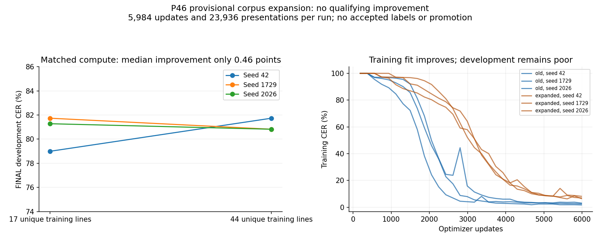
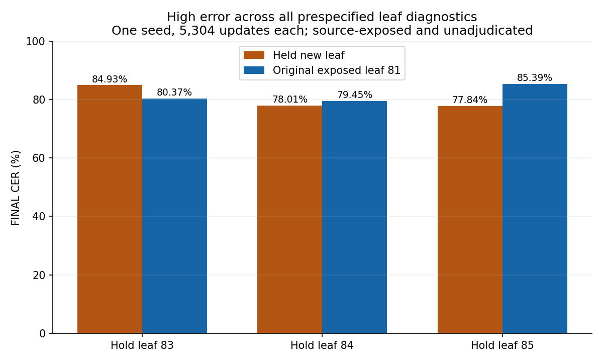
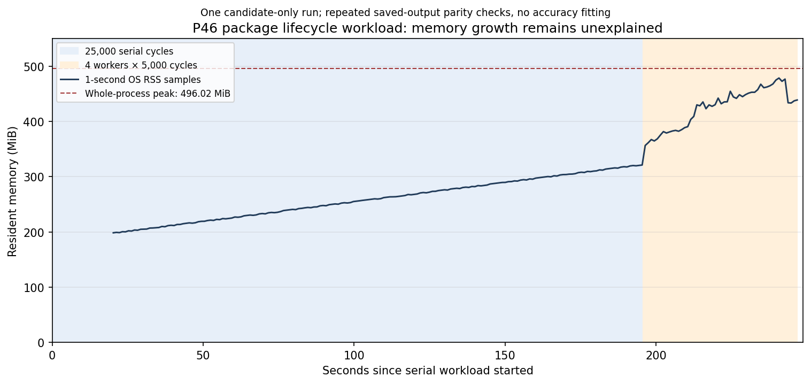

# P46 provisional corpus expansion — 2026-11-02 evening

The expanded corpus did **not** meet the registered improvement screen. Median final development CER changed from **81.28% to 80.82%**, only **0.46 percentage points**; two of three paired seeds improved, but the required five-point median gain did not occur. Three separately preregistered leaf diagnostics also remained poor, at **77.84–84.93% CER**. No model is promoted.

The owner renewed a two-hour session beginning **18:07:20 CST / 00:07:20 UTC on November3**, with cutoff **20:07:20 CST / 02:07:20 UTC on November3**. This is a separately versioned provisional study, preserving the [earlier closed comparison](p46-two-hour-study.md). It does not publish `P46-reviewed-v1`, accept scholarly decisions or establish reliable Greek transcription. The versioned crop-to-tensor transform, model training and inference are C#. Separate Python artifact scripts also parse/filter source references, construct geometric derivative crops, orchestrate processes and audit/plot results; they are not product runtime. P46's external rectification is not falsely presented as an implemented C# page-inference route.

## Corpus and source checks

The [new frozen corpus](../data/p46-expanded-provisional-corpus.md) adds **27 provisional source-reference lines / 926 scalars** from the six already staged Michigan surfaces1470–1520, proposed leaves83r/v–85r/v. Together with the unchanged old17 lines/578 scalars on leaf82, this gives **44 unique training lines / 1,504 scalars**, a2.60× increase in reference characters. The original **7 development lines /219 scalars** on page1440/leaf81 remain unchanged and already exposed. Earlier metadata-only leaves78–80 were not opened or assigned to a split.

Independent source/image QA checks all six full pages and27 crops, exact TEI references, source/crop hashes and per-pixel sampling maps. All **132 frozen content files** are rehashed. Of162 source rows,134 have markup/partial-word hazards and another plain row,1500L13, is excluded because a photographic hole may intersect strokes. No row is repaired from a familiar edition. Source/image terminal counts and generic side-caption conflicts remain explicit; crop associations are proposals, not expert adjudication.

Targets remove editorial whitespace, use NFD, and retain source lowercase spelling and separateσ/ς. All accepted `visible_text` and reviewer fields remain empty; reviewed training eligibility is false. Original source TEI, supplied/unclear/apparatus/abbreviation/continuation flags, exclusions and alternatives remain available. The [independent review](p46-expanded-corpus-review.md) is AI engineering/source QA, not Greek-specialist acceptance.

Authoritative training rasters are1695×64 RGB PNG geometric derivatives of the official width2200 review JPEGs, with exact source-X/Y maps, decoder context and hashes. They use nearest-neighbor column translation; they are not untouched rectangles or native-resolution accepted polygons. Generic page inference does not automatically reproduce that external geometry. Exact Michigan item PDM1.0 and INTF TEI CC BY4.0 notices/attributions are retained. No model redistribution license is assigned.

Corpus `FREEZE.json` SHA-256 is `7be31665294845287b7c3b5561308302599796722e32ea89cc1531952b058e1b`; the independent allowlist is `999cdba92ef727a971d3db77133a5b138dfcfee230c8e789f5986fbaae5faa48`. The C# harness verifies the complete freeze and per-ID QA text/crop/image/TEI digests, rather than merely accepting matching IDs. The new subset adds no mark/polytonic coverage or new hand/witness/Classical Greek/inscription validation. ψ still occurs only once; improved counts forγ/ξ/χ/φ do not establish adequate visual coverage.

## Technical control and frozen comparison

Before comparison, register the historical four training-only IDs1450L05/L08 and1460L03/L06, full original training alphabet, seed42 and a4,000-update cap. Raw luminance at height16 reaches **2/134 =1.49% training CER at1,655 updates**,18.75seconds, with nonempty output on every line and exact latest/selected reload. This is a self-fit technical control, not held-out accuracy. All24 old raw-height16 input hashes reproduce the earlier experiment before fitting.

The two comparison conditions change the training corpus while keeping raw luminance height16, hidden64, downsample4, dropout0, batch4, LR0.003, weight decay0, greedy decoding and no augmentation. The shared alphabet is training-only and identical to the old25 labels plus blank; development labels do not enlarge it. All51 exact inputs are424×16 float tensors with declared white background; float files, hashes and quantized previews are retained.

To ensure equal full-batch presentations, uniformly repeat the complete old17-line list **four times** (68 instances/17 batches); the44-line condition needs one copy (44 instances/11 batches). This preserves relative weights within each corpus and does not create new unique examples. The LCM of17 and11 is187, so freeze **5,984 updates /23,936 presentations** per run:352 old-data epochs versus544 expanded-data epochs. Actual reference-scalar presentations are813,824 versus818,176 because mean line lengths differ slightly. History training diagnostics count repeated instances (68 and2,312 scalars for old); final training metrics use unique lines.

Use seeds42/1729/2026 in separate processes, interleaved old/expanded pairs. Scheduled detailed diagnostics share187-update boundaries. Validation still runs each epoch, so the expanded condition has more development observations. **Primary comparison is the final fixed-budget checkpoint**, avoiding selection-opportunity differences; development-selected checkpoints/packages are secondary diagnostics. Patience covers the complete epoch budget and no target/early stopping truncates a comparison run. The latest checkpoint is retained and independently reloaded; the distributable-style package is explicitly labeled secondary, not the primary candidate.

Before the first comparison score, freeze source/project/DLL receipts, dataset/float hashes, exact corpus/QA/control-result hashes and process order. The registered provisional screen is≥5 percentage points lower median **final** development CER plus wins in≥2/3paired seeds. This is an experiment screen on one exposed leaf, not a scholarly release criterion. No automatic default change, deployment or promotion follows.

## All six comparison results

| Condition | Seed | Final unique-train CER | FINAL development CER | Secondary selected development CER |
| --- | ---: | ---: | ---: | ---: |
| Old17 | 42 | 2.60% | 173/219 =78.9954% | 77.17% |
| Expanded44 | 42 | 8.18% | 179/219 =81.7352% | 79.91% |
| Old17 | 1729 | 3.11% | 179/219 =81.7352% | 78.54% |
| Expanded44 | 1729 | 6.98% | 177/219 =80.8219% | 78.08% |
| Old17 | 2026 | 1.73% | 178/219 =81.2785% | 77.17% |
| Expanded44 | 2026 | 6.45% | 177/219 =80.8219% | 75.34% |

Old final median/range is **81.2785% /78.9954–81.7352%**; expanded is **80.8219% /80.8219–81.7352%**. Paired expanded-minus-old edits are **+6,−2,−1**. The median gain is one edit on219 reference scalars: **0.4566 points**, insufficient for the five-point gate. Do not promote the favorable expanded2026 secondary score of75.34%: it is not the primary fixed-budget result. Secondary medians actually worsen from77.17% to78.08%.

Expanded training fit remains worse at the same presentation budget, even as held-leaf error stays high in both conditions. This does not prove that more reviewed data or a different compute budget cannot help. It shows that this particular conservative expansion, representation, architecture and fixed budget did not clear the prespecified screen. Do not launch a post-result epoch/seed/decoder search on the same exposed development leaf.

## Prespecified new-leaf diagnostics

At18:29:26 CST, before any comparison or held-leaf scores, register three fixed folds holding out both surfaces of proposed new leaf83,84 or85. Original leaf82 remains training in every fold. Seed1729, raw height16 and all optimizer/architecture settings stay fixed; the alphabet comes **only from the original17 training lines**. No OOV line is dropped or relabeled; no held label enlarges the vocabulary.

Train counts32/34/39, whole-list copies1/2/4 and8/17/39 full batches yield a shared **5,304 updates /21,216 presentations** (663/312/136 epochs). The original exposed development leaf81 may supply secondary validation during fitting; the newly held leaf is scored only at the **final** checkpoint. All folds are executed without a score gate, parameter selection, retry or promotion. Execution/source/DLL/input receipts are frozen after the main six structural completion checks and before any fold fit.

| Held proposed leaf | Unique train lines | Held rows / scalars | FINAL held edits / CER | FINAL original leaf81 CER |
| --- | ---: | ---: | ---: | ---: |
| 83 | 32 | 12 /418 | 355/418 =**84.93%** | 80.37% |
| 84 | 34 | 10 /332 | 259/332 =**78.01%** | 79.45% |
| 85 | 39 | 5 /176 | 137/176 =**77.84%** | 85.39% |

Pooled newly held edits are **751/926 =81.10%**, macro leaf CER80.26%. These aggregate three different models, not one model evaluated on all new leaves. The common old-development observations are the same7 lines/219 scalars under three models, not21 independent lines. All held sources were already source-exposed and their references/geometry are unadjudicated; these are model-held-out diagnostics, not fresh blind acceptance or unseen-hand results.

The high error across all three new leaf folds weakens an explanation confined to page1440's faint appearance. It does not isolate a cause: appearance, content, crop/label uncertainty, sample size, representation, capacity and optimization remain confounded. No source reading, crop or model parameter is changed after these results. [The diagnostic report](p46-leaf-diagnostic.md) retains registration, final-only scoring boundaries, exact strings, model/source hashes and resource limits.

## Appearance, resources and independent verification

The [read-only appearance audit](p46-expanded-appearance.md) uses all51 exact C# float inputs, a preregistered interior region and full-width sensitivity check. Old24 input/statistic records replay exactly. New training lower-tail luminance remains near old training, while its contrast proxy numerically overlaps development; paper brightness, text density, side, margins, damage and rectification confound these mixture statistics. The character/leaf expansion is demonstrated; **faded-condition coverage is not**. No threshold or corpus selection changes follow the audit.

macOS `/usr/bin/time -l` records whole-process maximum RSS in bytes. Old-data processes peak at **212.70 /210.16 /215.00 MiB** for seeds42/1729/2026; expanded peak at **213.19 /197.17 /222.09 MiB**. These are one process per row, including initialization/input verification/training/evaluation/packaging, not isolated steady-state or training-only memory. The epoch-validation frequencies differ, so wall time is not a pure optimizer-throughput comparison. Runtime peak-API zero remains unavailable, not zero RAM. Leaf diagnostic training timers are about35seconds each and their process peaks are separately retained.

An independent instance recomputes **all603 final/secondary prediction records** (450 main,153 leaf), NFC scalar edits and reference counts, update/presentation/epoch budgets, disjoint fold IDs, source/crop/input receipts, checkpoint digests, reload flags and Darwin RSS units. The [independent audit](p46-expanded-study-independent-audit.md) confirms the failed improvement screen. All97 frozen source files,7 main dependency DLLs,132 corpus files and51 inputs agree at audit. The diagnostic has its separate executable/DLL snapshot. All latest checkpoint replays and secondary-package input/prediction checks pass.

The session's registered real-P46 training totals **53,471 updates**:1,655 control +6×5,984 comparisons +3×5,304 diagnostics. Resource/lifecycle regressions use separate synthetic fixtures and are not additional accuracy evidence. No earlier study, receipt, source packet, original split or pending specialist worksheet is modified.

The separate [closed-output error audit](p46-expanded-error-patterns.md) recomputes69 final evaluation records:the same7 development lines under6 main models plus27 distinct new held lines under3 different models. All records are nonempty; none is an exact line. Expanded predictions are shorter than old-data predictions at every paired seed. Newly held outputs contain10 insertions,279 deletions and462 substitutions; their total length is70.95% of the reference length. On surface1480, length is92.8% of reference but CER remains92%, so shortening alone cannot explain the failure. Minimum-edit scalar alignments are descriptive and tie-dependent, not independently localized glyph confusions or grounds for changing a source reading.

## Engineering and remaining gates

Three demonstrated correctness fixes accompany this session. `CtcTrainer` now disposes its owned Adam state while keeping its caller-owned model usable. New CLI training builds its vocabulary from training lines only, reporting development OOV glyphs with source IDs/counts before model/checkpoint creation. The recognition loader releases the model and construction/load temporaries when a digest-valid weight file is unreadable, preserving the original exception and successful caller ownership. Baseline failures and candidate tests are recorded in [the trainer/alphabet report](trainer-lifecycle.md) and [the failed-load report](model-load-lifetime.md). Optional source IDs preserve the old constructor/null JSON representation, but can distinguish record equality when IDs differ; this is a review boundary, not an assertion of unchanged equality semantics. Existing model alphabets, pixel transforms and scoring are not reinterpreted.

The installed TorchSharp raw-tensor-to-Parameter transfer can leave `Tensor.TotalCount` increments after both handles are empty. The failed-load regression therefore uses independently validated thread-local disposal statistics and explicit handle/ownership controls. The earlier invalid zero-counter experiments remain disclosed. This evidence establishes the tested lifetime boundaries, not universal native-memory behavior.

After the last production revision, the serial solution build has **zero warnings/errors**, and the named combined regression set passes **493 tests with zero failures/skips**: 264 ML, 27 CLI, 126 Application, 20 Worker, 56 API. Long P01 parameter-search experiments are excluded by filter rather than represented as executed acceptance checks. A separate inference-only C# replay reproduces **851 exact saved strings**:603 current study/leaf records,8 control records and240 historical selected-checkpoint records. Historical v2 replay supplies its recorded raw-height32 profile explicitly; its legacy defaults are unchanged. Replay proves output preservation, not recognition correctness. The [final verification receipt](../../.artifacts/experiments/p46-evening-report/final-code-verification.json) links the exact build/TRX/replay hashes.

The [frozen maintainer packet](../handoffs/p46-evening-maintainer-review.md) contains a narrow five-production-file/three-test-file patch, exact immediate before/candidate sources, reproducible baseline failures and passing controls. Its 21-file freeze receipt is `cd44091825aa492448913ccbfacc0294cae59a85545e52a0503aed4ce9245c05`. It preserves the already dirty-worktree baseline instead of pretending these fixes apply directly to clean HEAD. Human review, DCO certification, submission and acceptance remain pending; no commit, merge or release occurs. A separate [SourceId consumer audit](labeled-line-identity-audit.md) finds no current whole-line equality/hash consumer among the inspected production/test paths; it explicitly preserves the external-client equality limitation and does not mutate the frozen packet.

A separate preregistered [bounded lifecycle stress](lifecycle-stress.md) completes **600 successful model loads,1,200 expected corrupt-weight failures and4,200 exact repeated checks of the same 7 saved strings** across200 serial cycles and4 independent synchronous workers×100cycles. Each tested lifetime boundary returns to baseline; disposed parameter handles are empty. Another 100 short-lived trainers complete200 finite **synthetic** updates while preserving caller resources, without evaluation/CER/checkpoints. The process peaks at244.70MiB; this candidate-only observation is not a matched throughput or sustained-memory guarantee. It does not add independent Greek evaluation lines.

The separately preregistered [longer resource-only workload](sustained-lifecycle.md) finishes25,000 serial and4×5,000 independent-worker cycles: **45,000 valid loads,90,000 expected corrupt-weight failures and315,000 repeated saved-string checks** in249.21seconds. Lifecycle/parity assertions pass, but **memory stability is unresolved**. The226 OS samples rise by240.41MiB from first to last, with chronological-quarter medians217.38/258.34/298.32/430.11MiB; whole-process peak is496.02MiB. Sampling begins20.23seconds after the serial phase starts, and its478.45MiB sampled maximum omits the subsecond whole-process peak. Balanced live-wrapper counters do not explain RSS growth. Do not attribute it to allocator caching or call it a native leak without further evidence. No baseline speed/memory acceptance follows from this single current-build run.

A final separately registered [five-route resource probe](p46-memory-investigation.md) completes3,000 cycles in each fresh process: construction, successful loading without inference, empty/truncated failed loading, and retained-one-model inference. All lifecycle assertions pass; the retained model reproduces21,000 repeated saved strings. From cycle500 to3,000 its sampled RSS changes174.53→174.66MiB, while repeated loading/failure routes continue growing over that interval. Post-work forced GC substantially lowers managed live-memory estimates with little RSS reduction. This narrows the next profiling question; different first-operation baselines, short duration and one process per route preclude a causal or stability conclusion. Forced GC is an observation, not a production fix.

NT-15/17/18 remain open: the source/crop QA is not human adjudication, no reviewed corpus or fresh acceptance set exists, and broader Greek coverage remains absent. Next, a named Greek specialist and independent reviewer must confirm the51 current line identities/targets/maps, resolve visible versus restored/abbreviated/marked targets and exclusions, and add reviewed condition/rare-character diversity. These tasks can proceed alongside A's deterministic loader/resource checks under the existing disjoint A2/B2 briefs. More rows alone do not guarantee usable recognition.

Before another accuracy search, freeze a new concrete hypothesis and its scope. The current data show both incomplete expanded training fit and severe generalization gaps across leaves; they do not choose between more reviewed data, altered representation or model design. Any proposed resolution/sequence-scale or regularization comparison needs training-only learnability checks and a new matched protocol, rather than relaxing this failed screen or selecting a favorable secondary checkpoint. Keep earlier78–80 contents with the evaluator's exposure decision and obtain another witness/hand before generalization claims. NT-20 retains sustained/concurrent and supported-platform checks not supplied by the narrow trainer/loader lifetime regressions. A separately registered bounded stress supplement may reduce only its explicitly tested local-route gaps; it cannot reconstruct the earlier full-budget training RSS or establish universal behavior.

## Artifacts and reproduction

All experiment/data prefixes below are local Git-ignored evidence, not bundled production models:

- `.artifacts/datasets/ntvmr-pilot/expansion-provisional-2026-11-02-evening/`:132-file frozen source/crop/map/reference fork and blank accepted fields.
- `.artifacts/experiments/p46-evening-corpus-review/`: independent27-ID/source/pixel allowlist and final maps.
- `.artifacts/experiments/p46-expanded-study-2026-11-02-evening/`: C# harness/project, control/comparison protocols, complete dependency source snapshot, frozen DLLs, dataset,51 exact floats/previews, all seven run histories/checkpoints/strings and secondary packages, fixed process execution receipt and raw external resource logs.
- `.artifacts/experiments/p46-evening-leaf-diagnostic/`: prospective registration, execution freeze, C# harness, three fold histories/final strings/checkpoints,154-file summary receipt and external resources.
- `.artifacts/experiments/p46-evening-appearance-audit/` and `p46-evening-results-audit/`: preregistered float appearance method/results and independent603-record accounting audit.
- `.artifacts/experiments/p46-evening-report/`: plotting/report checks; exported figures are retained with this document.
- `.artifacts/experiments/trainer-lifecycle/`, `training-alphabet/` and `model-load-lifetime/`, plus `.artifacts/test-results/trainer-lifecycle/`: baseline/candidate source patches, synthetic reproductions, corrected resource-oracle controls and TRX evidence.
- `.artifacts/experiments/p46-evening-replay/`: post-loader inference-only replayer and851 exact-string receipt.
- `.artifacts/experiments/p46-evening-lifecycle-stress/` and `p46-evening-sustained-lifecycle/`: separately registered ownership/parity workloads, full OS sample series, monitor and descriptive resource evidence. Their live-counter passes do not close the RSS-growth issue.
- `.artifacts/experiments/p46-evening-memory-discrimination/`: prospective five-route/GC registration, exact source/binary/input guards and45 boundary observations, with no quality evaluation or production change.
- `.artifacts/reviews/p46-evening-engineering-2026-11-02/`: immutable narrow engineering review packet; it contains no copied corpus images or model binaries.

The main harness takes explicit workspace/output roots and cutoff when registering a new study; it refuses existing protocols/runs and checks source/binary/data/QA digests. Its project compiles only `Program.cs`, excluding archived source snapshots from automatic compilation. The leaf harness has its own fixed closed registration and must not be repurposed by removing guards. For a future authorized reproduction, use an isolated copy of the full frozen dependency tree and original hashed data, assign a new output/cutoff/registration, preserve the adaptation diff and prepare new receipts before fitting. Later engineering may intentionally change current source hashes; frozen training snapshots remain authoritative. Build serially with cached dependencies and do not overwrite evidence. CPU seeds are controls, not a promise of bit-identical weights across processes.

## Session closure

The authorized18:07:20–20:07:20CST window is complete; actual closure is **2026-11-02 20:07:32 CST**. The real-P46 fits closed earlier within that window; the remaining work covered engineering fixes, resource investigation and review. This is not two continuous CPU-training hours. NT-21 is archived; reviewed-data, acceptance and resource gates remain open. The [closure receipt](../../.artifacts/experiments/p46-evening-report/SESSION-CLOSE.json) and [content index](../../.artifacts/experiments/p46-evening-report/SESSION-INDEX.json) retain final source/document/evidence hashes. The index excludes build bin/obj trees and itself. No model promotion, submission, commit or release occurs.
