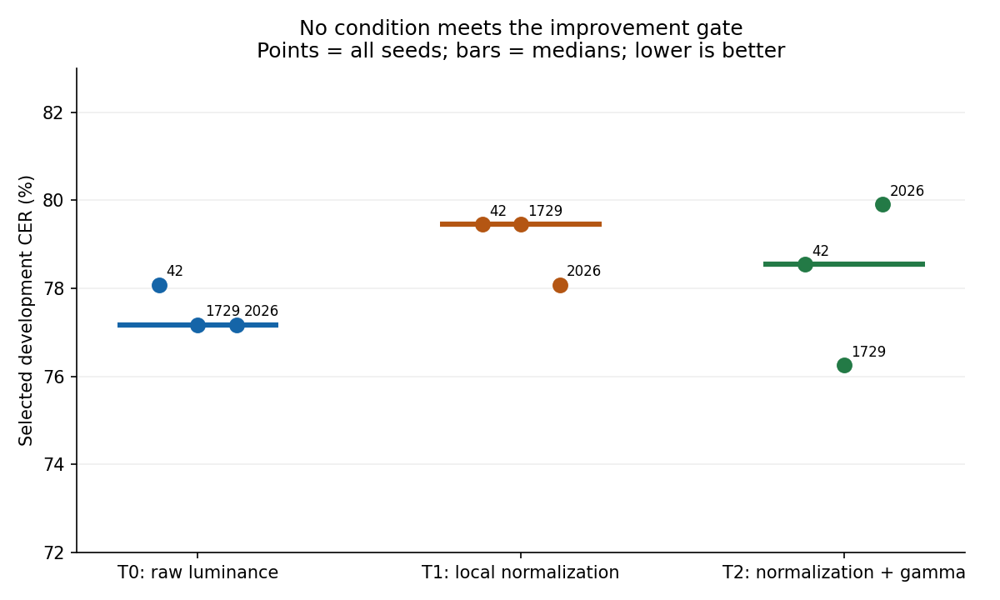
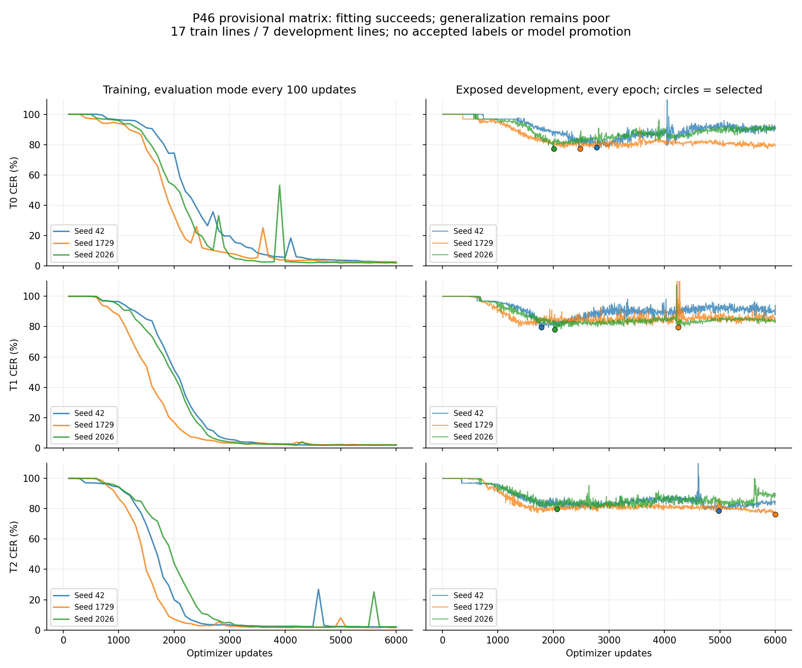

# P46 provisional training study — 2026-11-02

The fixed nine-run comparison found **no qualifying improvement** from local background normalization or normalization with gamma augmentation. No checkpoint is promoted. All three conditions fit the small training corpus, but fail to generalize to the exposed development leaf. The next useful training input is a reviewed, larger and more varied corpus, rather than another search on these seven development lines.

The owner authorized a two-hour session beginning **15:37:39 CST / 21:37:39 UTC**, with cutoff **17:37:39 CST / 23:37:39 UTC** on 2026-11-02. The bounded fits completed before the cutoff; subsequent session work verifies recovery, resources, regressions and the next source-review handoff. This document records a provisional engineering study. Specialist adjudication remains pending, and reviewed-data tasks NT-15/17/18 and scholarly release thresholds remain open.

## Data and experiment boundaries

- Reuse the frozen `.artifacts/experiments/p46-provisional-v2/` corpus: **17 training lines / 578 reference scalars** from leaf 82, pages 1450/1460; **7 development lines / 219 scalars** from leaf 81, page 1440. Both surfaces of leaf 82 remain together. No new source enters these fits.
- Keep the 25-label training alphabet plus CTC blank, original source/crop hashes, split assignments and pending specialist worksheets. All **81 line decisions and 18 specialist questions** remain unadjudicated. These plain provisional labels do not establish diacritic, abbreviation or apparatus accuracy.
- Development was already exposed and is used for checkpoint selection. There is no blind acceptance result, unseen-hand result, Classical Greek result or inscription result.
- Michigan's item-level PDM image notices and the exact INTF TEI CC BY 4.0 notices/attribution remain attached to source records. No model-weight redistribution license is inferred from them.
- Greedy decoding, CPU execution and the existing CRNN remain the baseline. All production training, inference and preprocessing use C#. Python is used only for report plots and artifact checks.

**Provenance correction:** the copied package attribution file incorrectly calls the actual rectified training inputs “unaltered rectangular selections.” [The corrective record](p46-source-provenance-correction.md) specifies the 64-pixel column-translation/ink-centroid geometry and the whitespace/NFD/source-case/sigma target conventions. Preserve that note alongside transferred research artifacts. Frozen package files remain unchanged so their receipts can still be verified; their historical description is not authoritative for training geometry.

## Training-only controls and bounded diagnosis

Choose four existing training-only lines before fitting: `P46-1450-L05`, `P46-1450-L08`, `P46-1460-L03`, `P46-1460-L06`, totaling 134 reference scalars. Use seed 42 and a maximum of 4,000 optimizer updates. This control evaluates the same four lines used for fitting; it is a technical learnability check, not held-out recognition accuracy.

| Preserved control | Input | Best training CER | Updates executed | Outcome |
| --- | --- | ---: | ---: | --- |
| Original study | Raw luminance, height 32 | 32/134 = **23.88%** | 4,000 | Failed; matrix withheld |
| Revision 2 | Local normalization, height 32 | 31/134 = **23.13%** | 4,000 | Failed; matrix withheld |
| Revision 3 | Local normalization, height 16 | 2/134 = **1.49%** | 1,594 | Passed provisional technical control |

The first raw run's final error was chiefly deletion. Switching only to the planned normalization did not solve fitting at height 32. A separately registered height-16 control then passed the ≤2% threshold with nonempty outputs and exact package/reload replay. Reducing height changes vertical detail, resampling, CTC length **212→106 frames**, recurrent input features **256→128**, and parameter count. This experiment does **not** isolate CTC length as the sole cause. Both failed controls remain preserved; neither was silently replaced by the passing result.

The original raw control also exposed a packaging defect after training: its 1,431,225-byte diagnostic manifest exceeded the existing loader's 1 MiB limit. Training outputs were preserved and later recovered without retraining; see the packaging record below. Its original elapsed-training timer was lost on packaging failure and is recorded as unavailable, not reconstructed.

Across the three substantive controls and nine matrix fits, execute **63,594 optimizer updates** (4,000 + 4,000 + 1,594 + 9×6,000). Training is bounded by the registered controls/matrix and does not run continuously for two hours: the session also includes implementation, input inspection, failure diagnosis, recovery, independent scoring, resource checks and source-review preparation. Additional recovery branch updates are counted separately below. No additional accuracy search follows the failed selection screen.

The final registered resource workload adds **6,000 training-only engineering updates**, described below, without development inputs, CER, validation or candidate checkpoints. Together these are **69,594 experiment/resource updates**, plus 40 copied-branch recovery updates and separate synthetic regression operations. Do not present the six resource processes as more accuracy comparisons.

## Frozen matched comparison

After the passing provisional control, freeze revision 3 at height 16 with otherwise matched conditions:

| Setting | Frozen value |
| --- | --- |
| Conditions | T0 ordinary luminance; T1 fixed local normalization; T2 T1 with training-only gamma |
| Seeds | 42, 1729, 2026, each in a separate process |
| Budget | Exactly **6,000 optimizer updates** per run: 1,200 epochs × 5 minibatches |
| Network | Hidden size 64, width downsample 4, dropout 0; 424×16 inputs |
| Optimization | Batch 4, learning rate 0.003, weight decay 0 |
| Other augmentation | No horizontal stretch, vertical shift or salt/pepper noise |
| Diagnostics | Every 20 epochs plus final; train/dev edits, lengths, blank statistics and three fixed samples |
| Selection | Lowest development CER, selected checkpoint restored; retain final checkpoint separately |
| Package verification | Exact input-float replay and decoded reload agreement |

T1's versioned `luminance-local-background-v1` recipe computes original-crop luminance, estimates a 90th-percentile background in 64×32 tiles, interpolates actual tile centers, divides by a background floor of 0.05, clips to [0,1] and resizes with float bilinear interpolation. Minimum width is 8; declared background is 1. T2 samples gamma uniformly from [0.9,1.1] during training only. Evaluation and inference apply T1 without random gamma. Identity gamma preserves legacy pixels, random-number draws and configuration hashes.

T1 also changes resampling/quantization relative to T0's historical Skia 8-bit resize. The comparison measures the **whole declared recipe**, and cannot attribute effects exclusively to background division. Transformed inputs were retained as exact little-endian floats and PNG previews and inspected before the matrix.

## All selected results

CER below uses canonical scalar edit distance against provisional references. “Selected training” is training-mode-independent evaluation of the checkpoint selected by development CER; “final” refers to the last fixed-budget checkpoint. Poor selected training scores in several seeds are real: development selection can occur before good fitting of training lines.

| Condition | Seed | Selected train CER | Selected dev CER | Final train CER | Final dev CER |
| --- | ---: | ---: | ---: | ---: | ---: |
| T0 | 42 | 24.39% | 78.08% | 2.42% | 89.95% |
| T0 | 1729 | 12.80% | 77.17% | 2.60% | 79.45% |
| T0 | 2026 | 52.77% | 77.17% | 1.90% | 90.87% |
| T1 | 42 | 65.74% | 79.45% | 1.90% | 94.06% |
| T1 | 1729 | 24.22% | 79.45% | 2.08% | 84.93% |
| T1 | 2026 | 49.31% | 78.08% | 1.90% | 83.56% |
| T2 | 42 | 2.42% | 78.54% | 2.08% | 84.47% |
| T2 | 1729 | 1.56% | 76.26% | 1.56% | 77.63% |
| T2 | 2026 | 41.87% | 79.91% | 2.08% | 88.58% |

| Condition | Median selected dev CER | Seed range | Paired wins against T0 | Decision |
| --- | ---: | ---: | ---: | --- |
| T0 | **77.17%** | 77.17–78.08% | Baseline | Retain as matched comparator |
| T1 | **79.45%** | 78.08–79.45% | 0/3 | Reject improvement claim |
| T2 | **78.54%** | 76.26–79.91% | 1/3 | Reject improvement claim |

The proposed research screen requires ≥5 percentage points lower median development CER and wins in at least two of three paired seeds, plus per-leaf safeguards. Neither condition clears even the aggregate screen. There is only one exposed development leaf, so the full D5 generalization gate cannot be satisfied here. The single favorable T2/1729 result is not selected for promotion. The older height-32 v2 score of 73.97% is a different experiment and is not this matrix's matched baseline.

All nine runs complete their budget. Final training CER is approximately 1.6–2.6%, while development remains 77.6–94.1%. Selected development outputs contain only 100–177 scalars for 219 reference scalars. By the final epoch, prediction/reference length ranges from 0.67 to 1.01, but substitutions remain 94–151 per run. The current failure is not merely an empty-output plateau. Normalization and this small gamma range do not establish robustness to the faint development leaf; inadequate coverage, provisional geometry/labels and model limitations still need separate evidence.

## Engineering delivered and recovery evidence

1. Add a validated, versioned local-background pixel recipe through the existing shared preprocessing contract. Legacy recipes and default polarity remain intact.
2. Add optional bounded gamma augmentation and an optional finite, nonnegative `TargetValidationCer`. Defaults preserve the previous augmentation/randomness/hash behavior; evaluation receives no random gamma. Target stopping preserves final diagnostics, counters and checkpoints.
3. Keep the 1 MiB inference-manifest limit. Oversized histories use bounded `training-run-details.json` with byte count and SHA-256 in a compact header. Scalar learning curves remain in the header where they fit; complete details remain in the sidecar. Ordinary model loading does not open it; explicit `TrainingRunManifestWriter.ReadRunDetails` checks the fixed filename, 64 MiB bound, digest and metadata/history agreement. Repackaging validates and preserves details. Small manifests retain their bytes.
4. Reject malformed pointers, recursive references, null histories/epochs and unsafe publication paths before copying package artifacts. Temporary-file replacement avoids following final-file links. Focused tests cover failure preservation as well as successful round trips.

Independent review additionally reproduced reserved output directories causing partial package publication; file-output preflight now rejects those directories before any copies and preserves existing sentinel files. A separate stopping regression reproduced a target crossed by less than the ordinary `1e-6` improvement tolerance leaving `.best` above target. The first actual target crossing now selects the passing checkpoint; null-target tolerance is unchanged. Both have failing-before/passing-after evidence. The latter does not affect these controls (CER increments are 1/134) or the matrix (target absent).

The preserved oversized raw control was repackaged into a **718,956-byte header** plus its exact original **1,431,225-byte details**. All 4,000 history rows, the selected model digest and four predictions replay exactly: CER remains 32/134. This is packaging recovery, not an improved model.

An independent recovery check copies the completed T2/1729 checkpoint into two new branches. One continues 20 optimizer updates; the other intentionally interrupts after 10, writes `.failure` at epoch 1,202 / update 6,010, reloads optimizer/model state and executes the remaining 10. On CPU with one thread, final parameter digests and all 24 decoded predictions match exactly at update 6,020. Caller evaluation mode is restored on success and failure. The original run remains unchanged. These **40 branch updates** are a functional recovery check, not additional model-selection candidates.

### Prompt tensor cleanup

An exact-runtime probe (TorchSharp0.107.0.0 / libtorch2.10.0.0) found 30 small repeated recognition calls increasing live tensor-alias count from **16 to 436** until forced garbage collection returned it to16. An enclosing disposal scope kept it at16 throughout. This demonstrates deferred finalizer cleanup, **not a permanent leak, native byte count or cause of the poor Greek CER**. [TorchSharp's memory guidance](https://github.com/dotnet/TorchSharp/wiki/Memory-Management) explains the difference between finalizer-based cleanup and scopes covering temporary tensor aliases.

Add precisely one disposal scope per training minibatch, evaluation minibatch and recognition call; keep model/optimizer construction and checkpoint loading outside. No forward API, tensor arithmetic, model format or forced production GC changes. Five regression cases fail before and pass after, covering repeated calls, multiple batches, partial-collation exceptions, nested caller scope/input ownership, modes and surviving managed results. Three synthetic Adam steps match all **9,243 parameters** and losses against direct reference operations; a fourth checkpoint-resumed update also matches. Post-fix calls remain at16 aliases, and all **48 frozen tensors / 216 selected predictions** still match exactly. Final optimizer/trainer disposal, concurrent/GPU behavior and allocator byte use are outside this alias-count proof. Separate inference resource measurements quantify the scoped change; Original accuracy-matrix training peak RSS remains unmeasured.

## Resource measurements and verification

The nine matrix fits each took approximately 40–45 seconds on this machine. Their runtime `Process.PeakWorkingSet64` values were zero on macOS and are treated as **unavailable**, not zero RAM. A separate fixed-seed inference benchmark records warmed preprocessing, recognition and combined latency and uses Darwin `/usr/bin/time -l` for whole-process peak RSS. Its results are recorded separately from accuracy selection.

The frozen-binary benchmark uses each condition's selected seed-1729 checkpoint, the same 24 already-decoded RGB crops, CPU threads 2 and batches up to four grouped by original split (seven batches per pass). Each stage has five warmup passes and 30 measured passes; file I/O, PNG decoding and model load are outside warmed latency. Median/p95 refer to whole **24-line passes**, not individual-line latency percentiles. Natural GC remains included. Each condition runs once in a separate process; this is a machine-local observation, not a cross-machine or seed-spread claim.

| Frozen condition | Prep median / p95, ms | Recognition median, ms | Combined median / p95, ms | Combined lines/s at median | Whole-process peak RSS, MiB |
| --- | ---: | ---: | ---: | ---: | ---: |
| T0 | 1.58 / 1.95 | 12.40 | 13.72 / 14.11 | 1,749 | 432.81 |
| T1 | 305.57 / 311.22 | 12.33 | 318.63 / 324.42 | 75.32 | 428.27 |
| T2 | 308.70 / 316.52 | 12.44 | 322.85 / 348.03 | 74.34 | 446.11 |

All 72 condition-line frozen tensors and saved predictions match before timing. T2 has no random gamma during inference, so T1/T2 execute the same deterministic normalization recipe; timing differences are not a gamma inference cost. The full normalization recipe is substantially slower than raw luminance in the frozen implementation and did not meet the quality gate. The RSS values cover initialization, verification and all warm/timed stages in a fresh process, with filesystem caches not flushed. They are **not training peak RSS or steady-state RSS**. Original accuracy-matrix training peak memory remains unavailable.

### Subsequent exact-output optimization

Replace full per-tile sorting with deterministic exact nearest-rank selection, a bounded fallback sort for adversarial partitions and one reused 2,048-float workspace; cache horizontal interpolation brackets once per crop column. Keep all luminance, interpolation, clipping and resize arithmetic/order unchanged. This is an implementation optimization of the same recipe, not another image-processing hypothesis or fit. Existing and new sorted-reference/ordered/duplicate/partial-tile tests pass. All **48 frozen T0/T1 tensors** match both raw float bits and hashes, and **all 216 selected predictions** across the nine packages match. No accuracy results change.

A separate contemporaneous baseline/optimized benchmark repeats the same five-warmup/30-sample procedure with the frozen Training assembly and either frozen or optimized Recognition assembly. It verifies all 144 condition-line tensors and all 144 saved strings before timing and retains its own source/DLL/evidence hashes. The original benchmark's 20 evidence files remain unchanged.

| Condition | Baseline → optimized prep median, ms/24 lines | Baseline → optimized combined median, ms/24 lines | Combined latency reduction | Optimized lines/s at median |
| --- | ---: | ---: | ---: | ---: |
| T1 | 321.01 → 249.88 | 335.58 → 257.75 | **23.2%** | 93.11 |
| T2 | 318.50 → 246.29 | 321.91 → 256.88 | **20.2%** | 93.43 |

Optimized T0 combined median is 14.20 ms/24 lines. Normalized T1 remains approximately **18.1× slower** than that raw comparator. Recognition-only time remains around 12–13 ms. These single-process-per-variant observations demonstrate a local implementation speedup with identical output, not performance equivalence, a quality improvement or a memory improvement. Fresh-process RSS remains separately recorded, with the same limitations. The selected Greek models are still not promoted.

### Resource check after prompt tensor disposal

A final separate comparison uses the optimized pre-scope Recognition snapshot versus the scoped snapshot, with frozen Training used only to load packages. It repeats the same six-process inference procedure and passes all **144 tensor hashes / 144 decoded strings**. All 61 earlier resource evidence files still match their receipts.

| Condition | Before → scoped combined median, ms/24 lines | Before → scoped whole-process peak RSS, MiB |
| --- | ---: | ---: |
| T0 | 13.54 → 13.49 | 432.66 → 199.23 |
| T1 | 254.32 → 256.63 | 428.53 → 195.28 |
| T2 | 260.94 → 265.31 | 428.72 → 195.52 |

The observed peaks are approximately 54% lower for this controlled workload, with latency changes from −0.39% to +1.67%. One fresh process per variant/condition does not establish a universal speed or memory guarantee. These are inference-process peaks including initialization/verification; original accuracy-matrix training peak RSS remains unavailable. Scoped normalized T1 still costs approximately19× scoped T0. Preserve that cost and the negative accuracy decision rather than turn the memory result into a claim that normalization is beneficial.

### Bounded training-resource probe

Before execution, separately register six fixed processes: frozen R3 versus current implementation, T0/T1/T2, seed1729, CPU threads1, original17 **training-only** lines, height16/hidden64/batch4/LR0.003, fixed200 `TrainEpoch` calls =1,000 optimizer updates each. T2 retains gamma0.9–1.1 and other augmentation remains disabled. The 17 training references alone build the alphabet. Each process is capped at59seconds with no start after17:32 CST. All finish by17:27:25 without timeout. No development crop/label, `Fit`, evaluation, CER, recognizer, checkpoint or candidate selection is used.

| Condition | Frozen → current training seconds | Frozen → current whole-process peak RSS, MiB |
| --- | ---: | ---: |
| T0 | 6.040 → 6.119 | 308.41 → 203.13 |
| T1 | 6.069 → 6.116 | 306.42 → 193.39 |
| T2 | 6.781 → 6.319 | 312.52 → 193.39 |

All six complete exactly1,000 updates: **6,000 additional engineering updates**,1,200 finite per-epoch losses and102 matching prepared-training-input hash checks, with zero development/evaluation/checkpoint operations. The per-condition200-loss-sequence digests happen to match across processes; this is structural evidence, not an accuracy score or a promise of cross-process bit identity. Frozen live aliases at the final boundary are272/272/282 versus36 current; forced GC returns both implementations to36.

Observed peak process memory is approximately34–38% lower on this bounded workload. Each row is one fresh process per variant, with initialization/preprocessing included in RSS; preprocessing is outside the training timer. This compares the **whole frozen/current implementation bundle**, including exact normalization optimization and disposal changes, rather than isolating the causal effect of scopes. Timing is not a multi-sample speed claim. The original nine full6,000-update accuracy-matrix training peaks remain unavailable: this later1,000-update, single-thread, no-validation/checkpoint probe does not reconstruct them. Broader lifecycle/sustained/platform requirements remain NT-20. All101 earlier resource evidence files remain unchanged.

Final code verification includes **475 passing tests**: 249 ML, 24 CLI, 126 application, 20 worker and 56 API, with zero failures/skips. The full serial solution build has **zero warnings and zero errors**. Long P01 parameter-search experiments are deliberately excluded from the ML regression selection; no claim is made that they ran. Profile/pixel/package/task tests cover unchanged legacy contracts and the new recipe; P46 exact replay and synthetic ownership/Adam tests establish the scoped compatibility claim. This is not a fresh real-corpus accuracy evaluation across all materials, operating systems or hands, and does not satisfy a model-release gate.

Independent scoring recomputed all **216 selected line predictions** and verified selected checkpoint digests. A separate integrity check verifies **170 indexed matrix artifacts** and all **8 original v2 receipt files** without mismatches. Exact prepared-float and reload checks pass for every matrix package. Final-epoch all-line strings were not retained; their aggregate diagnostics are checked against history rather than presented as independently rescored strings.

## Next handoff and stopping rule

Stop this preprocessing search after the closed matrix. Do not train longer on the same exposed development set, move page 1440 into training, promote a favorable seed or relax the recorded gate to manufacture an improvement.

The corpus/reviewer instance owns NT-15: adjudicate the existing packet, source/crop identity, visible versus supplied text, abbreviations and corrections; build reviewed physical-leaf-disjoint partitions toward 100 train / 30 dev / 30 reserved acceptance lines and the planned eight leaves; include faded training material. The [six new Michigan source candidates](../data/p46-expansion-candidates.md) cover 83r/v–85r/v, NTVMR 1470–1520. Exact institutional PDM notices and INTF CC BY notices are retained. These candidates are source-exposed, unassigned and unreviewed. Caption/side conflicts and terminal TEI line-count discrepancies remain explicit questions; the inventory's 162 `<lb>` elements are not a usable-line count.

The six official width-2200 full-page review derivatives are now staged with unchanged bytes, original TEIs/manifests, attribution and hashes in a portable offline source-review packet: six pending page worksheets and eleven pending questions, no line crops or accepted labels. Its 48-file ZIP is **8,778,841 bytes**, SHA-256 `4a80e1995f7df14dd3df5b0ce05ca50d33c98b76a0faddfcb378733b92ab42a8`. Contact-sheet inspection checks presentation only. [The corpus handoff](../handoffs/NT-PILOT-B.md) records exact evidence hashes, unresolved page/side/count issues and the required reviewed dataset conversion. Nothing was sent to a reviewer or institution.

A separate [metadata-only inventory](../data/p46-earlier-leaves-candidates.md) identifies three earlier proposed Michigan leaf pairs, 78r/v–80r/v, pages1370–1420. Exact item image manifests state PDM1.0. Transcription pointers are present, but their TEI bodies/license headers and image pixels were not fetched or opened; image availability and visual identity remain unchecked. These six surfaces could bring the source inventory to eight physical leaves, subject to verification. The evaluator must decide whether metadata/passage-index exposure is compatible with the future protocol; they are not an accepted blind set. APIS IDs cannot be generated by arithmetic: capture152 is APIS3604, while3605 returned404.

The training instance then owns a new reviewed technical control and a separately frozen, matched experiment. It receives declared pixel profile plus reviewed source/crop transforms, rights/attribution, dataset hashes, alphabet/rare-character coverage, leaf grouping, exposure ledger and evaluator-owned thresholds. Retain greedy decoding as the comparator. Changes to architecture, regularization or pretraining require their own concrete hypothesis and budget; this study does not establish which one will help. Fresh, unexposed acceptance leaves and profile-matched regression/resource evidence precede any promotion. Broader Koine/Classical hands and inscriptions require additional witnesses and collections; P46 alone cannot validate that scope.

The durable [B2 corpus brief](../tasks/p46-reviewed-corpus.md) and [A2 training brief](../tasks/p46-next-training.md) assign exclusive paths, independent work, reviewed dependencies, acceptance and handoff requirements. Alphabet and learned preprocessing use training data only; development OOV cases are reported, not silently dropped or relabeled. The corpus instance reviewed these briefs for ownership/leakage consistency. Their publication does not start the next assignment or manufacture missing specialist acceptance.

## Reproduction artifacts

All experiment folders are Git-ignored local artifacts, not bundled distributable models:

- `.artifacts/experiments/p46-study-2026-11-02/`: failed raw height-32 control, protocol, original oversized package and frozen source.
- `.artifacts/experiments/p46-study-2026-11-02-r2/`: failed normalized height-32 control.
- `.artifacts/experiments/p46-study-2026-11-02-r3/`: passing height-16 control; frozen protocol, input floats/previews, source snapshot and binary digests; all nine run configurations/checkpoints/history/predictions; `matrix-summary.json` and `matrix-artifact-index.json`.
- `.artifacts/experiments/p46-study-recovery/`: raw-control package recovery C# harness and results.
- `.artifacts/experiments/p46-resume-verification/`: interrupted/uninterrupted C# recovery harness, copied branches and exact-parity results.
- `.artifacts/experiments/p46-study-resources/`: isolated C# resource harness and measurements.
- `.artifacts/experiments/p46-study-resources-optimization/`: separate contemporaneous frozen/optimized latency and inference-RSS comparison, raw samples and unchanged-original evidence receipt.
- `.artifacts/experiments/p46-study-resources-scoped/`: final before/after-disposal inference latency/RSS comparison, correctness checks and prior-evidence receipt.
- `.artifacts/experiments/p46-training-resources/`: pre-execution registration, train-only manifest, six capped1,000-update resource processes, source/DLL/config hashes, actual OS peaks/time, finite-loss/alias diagnostics and prior-evidence receipt; no model package or quality evaluation.
- `.artifacts/experiments/p46-normalization-optimization/`: exact float-bit/hash and nine-package prediction parity harness/results.
- `.artifacts/experiments/tensor-lifetime-audit/`: exact installed-runtime alias-count, direct Adam/recovery and post-scope parity evidence.
- `.artifacts/experiments/p46-r3-reproduction-supplement/`: post-study 99-file C# dependency-closure supplement with per-file origins/hashes; isolated Training library restore/build succeeds with zero warnings/errors. It overlays the ten original R3 source snapshots and restores the pre-scope recognizer. It is explicitly not an original full-tree-at-training receipt; frozen binaries/results remain authoritative.
- `.artifacts/experiments/p46-study-report/`: plot/stratification script, page/edit diagnostics and integrity check.
- `.artifacts/test-results/two-hour-study/`: focused and final TRX results plus solution build log. Earlier local-normalization focused results are in `.artifacts/test-results/p46-two-hour/`.

Use the frozen C# study harness/source snapshot as a reproducibility reference; do not overwrite or extend the closed matrix. The runner hardcodes its revision-3 output directory and historical cutoff, checks source/binary digests and refuses preparation when runs already exist. **Copying it into another folder is insufficient.** A future authorized reproduction must use an isolated checkout/output tree, give the runner a new study-directory path and future cutoff, retain the original frozen data/recipe/configuration, then execute preparation to generate a separately versioned protocol/input/source/binary receipt before fitting. Preserve the adaptation diff and identify whether the frozen packaging writer or the later hardened writer is used. Never remove guards or rewrite old receipts to make changed code appear frozen. No such reproduction is started by this report.

Later packaging hardening and exact-output optimization intentionally change current source hashes. Restore only cached dependencies where available and build serially (`-m:1 -p:UseSharedCompilation=false`). The report plotting script reads saved results and does not fit or select new models. CPU seeds are recorded controls, not a promise of cross-process bit identity.

## Session closure

Authorized wall-clock window: **2026-11-02 15:37:39–17:37:39 CST** (21:37:39–23:37:39 UTC). Final closure recorded **17:38:10 CST**. All training-resource processes had completed by17:27:25; no later training or accuracy search was started. NT-19 is archived, while reviewed-data and remaining lifecycle/platform gates stay open. Final integrity checks reproduce475 passing tests, all779 indexed session files,170 matrix artifacts and8 original receipt files without mismatches. The original specialist archive and81 pending line decisions/18 unanswered questions remain unchanged. The separate resource probe index covers52 additional evidence files.
